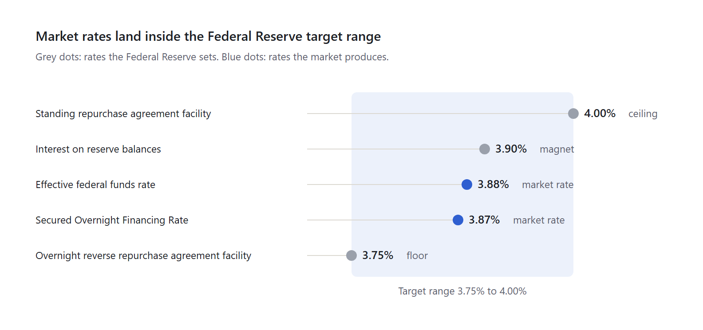

# How the Fed Moves Your Rates

*Part 2 of 7 · [Series overview](<Treasury Securities and the Interest Rate System (Main).md>)*

---

## How the Federal Reserve sets rates

The Federal Reserve targets the federal funds rate, set at 3.75% to 4.00% in September 2026, by setting the rates it pays and charges on its own facilities; it never orders banks what to charge.

The federal funds rate is what banks pay to borrow from each other overnight, without collateral. On September 16, 2026, the Federal Reserve raised its target range by 0.25 percentage points, its first increase since 2023, to fight inflation driven by energy prices. Its own projections point to one more increase in 2026. Decisions come at eight scheduled meetings a year.

Each decision has two parts: a headline target range, and an implementation note that moves the three rates the Federal Reserve controls directly.

| Federal Reserve tool | Who uses it | Role |
|---|---|---|
| Standing repurchase agreement facility | Banks and dealers borrow cash, pledging Treasury securities | Ceiling: nobody needs to pay more |
| Interest on reserve balances | Banks earn this on money kept at the Federal Reserve | Magnet: pulls market rates toward it |
| Overnight reverse repurchase agreement facility | Money market funds and agencies lend cash to the Federal Reserve | Floor: nobody needs to accept less |

*Federal Reserve implementation note, September 16, 2026; rates as of October 1, 2026*

> [!info] The same chart as a table
> The target range is 3.75% to 4.00%. Both market rates sit inside it, just under the rate the Federal Reserve pays on reserves.
>
> | Rate | Level | Role | Who sets it |
> |---|---|---|---|
> | Standing repurchase agreement facility | 4.00% | Ceiling | The Federal Reserve |
> | Interest on reserve balances | 3.90% | Magnet | The Federal Reserve |
> | Effective federal funds rate | 3.88% | Market rate | The market |
> | Secured Overnight Financing Rate | 3.87% | Market rate | The market |
> | Overnight reverse repurchase agreement facility | 3.75% | Floor | The Federal Reserve |

Both market rates settle just below interest on reserve balances, inside the band; [the section on the two overnight markets](<3 - How Overnight Lending Works.md>) explains why.

**Why the market follows without a rule:** the Federal Reserve will deal in unlimited amounts at its own rates. If it pays 3.90% risk-free, no bank lends to another bank for 3.50%. After September's increase, the Secured Overnight Financing Rate rose from about 3.65% to about 3.87% within days.

Before 2008, the Federal Reserve could not pay interest on reserves, so it steered the rate by changing the amount of money in the banking system. The federal funds rate stayed the official target; only the tools changed.

### How much cash banks keep at the Federal Reserve

There is no legal minimum anymore: the Federal Reserve cut the reserve requirement to 0% in March 2020. Banks now decide for themselves, guided by these forces:

| What drives it | How it works |
|---|---|
| Liquidity rules | Large banks must hold enough safe, easy-to-sell assets to survive 30 days of heavy withdrawals; reserves count fully, as do Treasury securities |
| Payments | Banks send trillions of dollars of payments a day through the Federal Reserve's payment system and need balances on hand |
| Internal stress tests | Big banks model worst cases and keep a cushion based on the results |
| Regulators' preferences | After the 2023 bank failures, supervisors pushed for more instantly usable cash |
| Economics | Reserves earn 3.90% risk-free, so a large buffer costs little |

Before 2020, banks had to hold up to 10% of their checking-type deposits as reserves, averaged over two weeks. Banks that came up short borrowed overnight from banks with extra, which is why the federal funds market existed in the first place. Today the Federal Reserve keeps reserves "ample," roughly &#36;3 trillion in recent years, so most banks rarely need to borrow.

### What "cash" means here

"Cash" in these markets means electronic dollars, not paper money, and never gold or platinum.

- **Reserve balances:** digital entries in a bank's account at the Federal Reserve. The Federal Reserve creates them electronically, for example by crediting a bank's account when it buys a Treasury security from that bank.
- **Paper currency:** bills in a bank's vault, which used to count toward reserve requirements but play almost no role in overnight lending.
- **Collateral:** Treasury securities in repurchase agreements; securities and loans for emergency borrowing from the Federal Reserve. No metals.

The United States ended dollar-to-gold conversion for citizens in 1933 and for foreign governments in 1971; dollars are now backed by law and trust in the government. The Treasury still owns a large gold reserve, but it plays no role in daily banking.

---

## How it reaches you

Credit cards react to the Federal Reserve within weeks, savings accounts loosely, and fixed mortgages hardly at all, because mortgages follow the 10-year Treasury yield instead.

| Your rate or asset | What it follows | When the Federal Reserve raises rates |
|---|---|---|
| Credit card | Prime rate (top of the target range + 3%, about 7% in October 2026) plus the card's markup | Rises within one or two billing cycles |
| High-yield savings account | Competition between banks | Rises within about one to two weeks |
| Big-bank savings account | The bank's choice | Barely moves |
| New fixed-rate mortgage | 10-year Treasury yield + about 1.5 to 2.5 points | Moves with long-term expectations |
| Existing fixed-rate mortgage | Locked in | Never changes |
| Adjustable-rate mortgage | Short-term benchmarks such as the Secured Overnight Financing Rate | Rises at the next reset |
| Stocks | Present value of future profits | Tend to fall; technology companies hit hardest |
| Existing bonds | Market yields | Prices fall |

**Small rate gaps are big money.** On a &#36;400,000, 30-year mortgage, the monthly payment is about &#36;2,398 at 6% and about &#36;2,661 at 7%.

**Stocks use the same math as bonds.** A company's value is the present value of its future profits, so a higher discount rate shrinks it. In 2022, rapid rate increases helped push the Standard and Poor's 500 down about 19% and the Nasdaq Composite down about a third.

**Surprises move markets, not decisions.** September's increase was widely expected and largely priced in beforehand; investors watch statements, projections, and inflation reports for changes in expectations.

---

## Related Documents

- **Previous:** [Part 1 — How Treasury Bonds Work](<1 - How Treasury Bonds Work.md>)
- **Next:** [Part 3 — How Overnight Lending Works](<3 - How Overnight Lending Works.md>)
- **Series hub:** [Treasury Securities and the Interest Rate System](<Treasury Securities and the Interest Rate System (Main).md>) — The big picture, the reading order, the rules to remember, and all sources.
