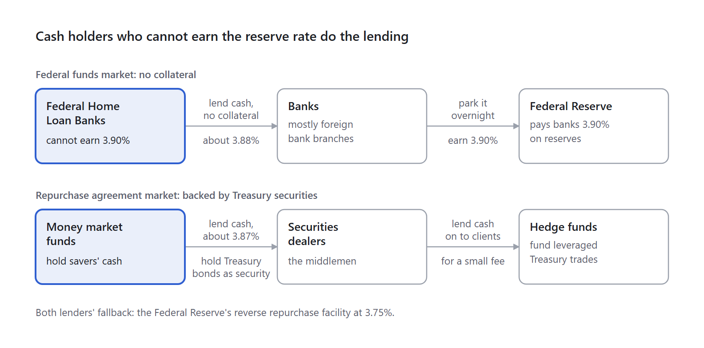

# How Overnight Lending Works

*Part 3 of 7 · [Series overview](<Treasury Securities and the Interest Rate System (Main).md>)*

---

Overnight lending happens in two markets, and both are driven by big cash holders who cannot earn the Federal Reserve's 3.90% reserve rate.

Banks that can earn that rate mostly leave their cash at the Federal Reserve. So the lenders are the Federal Home Loan Banks in one market and money market funds in the other, each lending just above their 3.75% fallback. The effective federal funds rate (3.88%) comes from the first market; the Secured Overnight Financing Rate (3.87%) from the second.

|  | Effective federal funds rate | Secured Overnight Financing Rate |
|---|---|---|
| Type of loan | Unsecured | Backed by Treasury securities |
| Who lends to whom | Federal Home Loan Banks lend to banks, mostly foreign bank branches | Money market funds lend to securities dealers and hedge funds |
| Daily volume | About &#36;100 billion | Trillions of dollars |
| Main use | The Federal Reserve's policy target | Benchmark for adjustable mortgages, loans, and futures |

*Who lends to whom in each overnight market · 2 markets, 6 players*

> [!info] The same diagram in words
> In both markets the lender is someone who cannot earn the 3.90% the Federal Reserve pays banks on reserves.
>
> - **Federal funds market (no collateral):** the Federal Home Loan Banks, which cannot earn 3.90%, lend cash with no collateral at about 3.88% to banks, mostly branches of foreign banks. Those banks park it overnight at the Federal Reserve and earn 3.90%.
> - **Repurchase agreement market (backed by Treasury securities):** money market funds, which hold savers' cash, lend it at about 3.87% to securities dealers and hold Treasury bonds as security. The dealers, acting as middlemen, lend the cash on to their clients for a small fee. Those clients are hedge funds, which use it to fund leveraged Treasury trades.
> - **Fallback for both lenders:** the Federal Reserve's reverse repurchase facility at 3.75%.

In both markets, the lenders are cash holders shut out of the 3.90% reserve rate, so they lend just above their 3.75% fallback.

---

## The federal funds market

**Who lends to whom:** the Federal Home Loan Banks supply the large majority of loans. The borrowers are mostly foreign banks' United States branches, plus some domestic banks. Nobody borrows because they are short on reserves; reserves are plentiful today.

**What is borrowed:** electronic reserve balances, for one night, with no collateral.

**How the rate is measured:** each day the Federal Reserve Bank of New York lines up every dollar lent, from lowest rate to highest, and publishes the rate on the dollar exactly in the middle (a volume-weighted median). A median ignores oddball trades, which makes it hard to manipulate.

**Why the rate sits just below 3.90%:** banks with spare cash simply leave it at the Federal Reserve, so they are not the lenders. The Federal Home Loan Banks cannot earn the reserve rate; their fallback is the 3.75% reverse repurchase facility, so they gladly lend at about 3.88%. A bank borrows that money and parks it straight back at the Federal Reserve: borrowing &#36;1 billion at 3.88% and earning 3.90% nets about &#36;556 a night, nearly risk-free.

The bank cannot pay all the way up to 3.90%, because deposit insurance fees and capital rules eat a few hundredths of a percent. Foreign bank branches are the biggest borrowers because they pay no United States deposit insurance fees, so the trade costs them less. Competition among borrowers pushes the rate up as far as they can afford: about 3.88%.

**What about JPMorgan Chase or Bank of America?** Big domestic banks barely trade here. They hold hundreds of billions of dollars in reserves, and their deposit insurance fees and extra capital rules make the 0.02-point gap not worth it. They still watch the federal funds target closely, because it sets their prime rate. Their real overnight activity happens in the repurchase agreement market, through their dealer arms.

**When the order flips:** this only works while reserves are plentiful. When reserves get scarce, banks short on cash bid for it, banks with spare reserves start lending, and the market rate climbs above the reserve rate (called "interest on excess reserves" before July 2021).

| When | Federal funds rate | Reserve rate | What happened |
|---|---|---|---|
| Early 2019 | About 2.40% to 2.45% | 2.40% | The Federal Reserve cut its reserve rate to 2.35% in May 2019 to pull the market rate back down |
| September 17, 2019 | 2.30% | 2.10% | A cash shortage pushed it above the entire target range |

The floor is soft too. In 2021, with cash extremely abundant, rates sagged toward the floor, and the Federal Reserve nudged its floor and reserve rate up by 0.05 points.

---

## The repurchase agreement market

**What is borrowed:** cash. The borrower owns Treasury securities, hands them over as collateral, and gets cash overnight, like a pawn shop for bonds. Legally it sells the securities and agrees to repurchase them the next day, which gives the market its name.

**One night, step by step:**

| When             | Securities dealer                                                  | Money market fund               |
| ---------------- | ------------------------------------------------------------------ | ------------------------------- |
| Tonight          | Delivers &#36;102 million of Treasury securities                   | Sends &#36;100 million in cash  |
| Tomorrow morning | Repays &#36;100 million plus about &#36;10,750 of interest (3.87%) | Returns the Treasury securities |

The extra &#36;2 million of collateral is the "haircut," a cushion in case bond prices drop overnight.

**Why divide by 360:** rates are quoted per year, and money markets count a year as 360 days by convention. One night's interest is amount × yearly rate ÷ 360; a week is × 7 ÷ 360. Treasury coupons, by contrast, use actual calendar days.

**When interest is paid:** at the end of the deal, together with the principal, as part of the "repurchase price." Nothing is paid upfront except the loan itself.

| Type | How long | When interest is paid | On &#36;100 million at 3.87% |
|---|---|---|---|
| Overnight | One night | The next morning, with the principal | &#36;10,750 |
| Term | A fixed period, rate locked at the start | Once, at the end | 30 days: &#36;322,500 |
| Open | Renews daily until either side cancels; rate resets daily | Builds up daily; paid when the deal ends or on a schedule, often monthly | Varies with each day's rate |

When a loan is rolled into a new one, the principal stays put; only the interest and any collateral top-ups actually move.

**How long repurchase agreements last:** most are overnight. In the tri-party segment, where money funds lend through a custodian bank, [the overnight portion is roughly 80%](https://www.financialresearch.gov/briefs/files/OFRBr_21-02_Dynamics_Overnight_Triparty_Repo_Market.pdf), and across the market [most deals are overnight](https://libertystreeteconomics.newyorkfed.org/2026/09/whos-borrowing-and-lending-in-repo-markets/). Term deals cost a little more but lock in funding; dealers often borrow overnight and lend for longer terms, carrying the rollover risk themselves.

**Who the players are:**

| Role | Who | Why they are there |
|---|---|---|
| Cash lenders | Money market funds (the biggest), Federal Home Loan Banks, large companies | A safe return above the 3.75% fallback, protected by Treasury collateral |
| Middlemen | Securities dealers: the trading arms of big banks, such as J.P. Morgan Securities, Goldman Sachs, and BofA Securities | Borrow from money funds and lend on to clients for a small fee |
| Cash borrowers | Dealers and hedge funds | Fund their Treasury holdings and leveraged trades |
| Plumbing | Custodian banks such as the Bank of New York Mellon, and the Fixed Income Clearing Corporation | Hold the collateral and settle trades so neither side has to trust the other |
| Backstop | The Federal Reserve | Takes cash at 3.75% (floor) and lends cash at 4.00% (ceiling) |

**Why the market exists:** dealers can buy billions at Treasury auctions without having billions in cash; cash holders get a safe place to earn interest; and any Treasury owner can turn bonds into cash overnight. That last point is a big reason Treasury securities count as the world's most liquid asset. Daily volume is roughly &#36;2 trillion or more.

**How the Secured Overnight Financing Rate is measured:** each morning the Federal Reserve Bank of New York takes the volume-weighted median of the previous day's repurchase agreement trades. It leaves out its own transactions and "specials," trades where the lender really wants one particular Treasury security rather than interest, which trade at unusually low rates.

---

## Related Documents

- **Previous:** [Part 2 — How the Fed Moves Your Rates](<2 - How the Fed Moves Your Rates.md>)
- **Next:** [Part 4 — Banks That Lend to Banks](<4 - Banks That Lend to Banks.md>)
- **Series hub:** [Treasury Securities and the Interest Rate System](<Treasury Securities and the Interest Rate System (Main).md>) — The big picture, the reading order, the rules to remember, and all sources.
- **[SOFR — Secured Overnight Financing Rate](<SOFR Future.md>)** — SOFR futures: contracts that bet on where the Secured Overnight Financing Rate will average in a future month or quarter.
