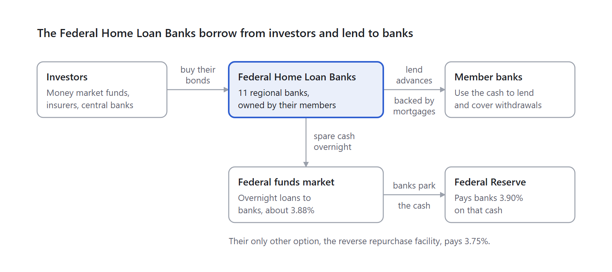

# Banks That Lend to Banks

*Part 4 of 7 · [Series overview](<Treasury Securities and the Interest Rate System (Main).md>)*

---

The Federal Home Loan Banks are 11 regional "banks for banks" that borrow from investors by selling bonds, then lend that money to member banks.

**What they are:** created by Congress in 1932 to support home lending, they are owned like a cooperative by their members (commercial banks, credit unions, insurance companies). Each serves a district of several states, from offices in Atlanta, Boston, Chicago, Cincinnati, Dallas, Des Moines, Indianapolis, New York, Pittsburgh, San Francisco, and Topeka. They are government-sponsored enterprises: created and supervised by the government, but privately funded, and their debt is not officially guaranteed. Investors assume implicit support, which lets them borrow at rates just above Treasury rates.

**What they sell:** "consolidated obligations," issued jointly through a shared Office of Finance. All 11 banks are responsible for every bond, so if one could not pay, the others would. These totaled about &#36;1.18 trillion at the end of 2024, about 98% of the system's funding.

|  | Consolidated discount notes | Consolidated bonds |
|---|---|---|
| Length | Under 1 year (4, 8, 13, 17, 26 weeks at auction) | 1 to 30 years, mostly 1 to 5 |
| How you are paid | Bought below face value, like Treasury bills | Fixed or floating interest, plus face value |
| Repaid early? | No | Often yes (callable) |

**What they do with the money:** they lend it to members as "advances," backed by mortgages as collateral. They are called the lender of next-to-last resort; struggling banks leaned on them heavily in the 2023 regional banking crisis. Spare cash they hold overnight goes into the federal funds market.

*How money moves through the Federal Home Loan Banks · 5 parties*

> [!info] The same diagram in words
> Money moves through five parties.
>
> 1. **Investors** (money market funds, insurers, central banks) buy the bonds of the Federal Home Loan Banks.
> 2. **The Federal Home Loan Banks** (11 regional banks, owned by their members) lend that money to **member banks** as advances, backed by mortgages. Member banks use the cash to lend and to cover withdrawals.
> 3. Whatever cash the Federal Home Loan Banks have spare overnight, they lend in the **federal funds market**, as overnight loans to banks at about 3.88%.
> 4. The banks that borrow it park the cash at the **Federal Reserve**, which pays banks 3.90% on it.
> 5. The Federal Home Loan Banks' only other option is the reverse repurchase facility, which pays 3.75%.

The same institution sits on both sides: it borrows from investors through bonds, and lends to banks through advances and overnight loans.

**How much collateral backs an advance:** advances must stay fully secured, and each type of collateral gets a haircut. To borrow &#36;1 million:

| Collateral | Typical haircut | Collateral needed |
|---|---|---|
| Treasury securities | About 2% to 5% | About &#36;1.02 to &#36;1.05 million |
| Government-backed mortgage securities | About 5% | About &#36;1.05 million |
| Single-family first mortgages | About 20% to 30% | About &#36;1.25 to &#36;1.43 million |
| Home equity loans | About 40% to 50% | About &#36;1.67 to &#36;2.0 million |
| Land and construction loans | About 50% | About &#36;2.0 million |

These are typical ranges from the [Federal Home Loan Banks' disclosures](https://www.fhlb-of.com/ofweb_userWeb/resources/lendingqanda.pdf) and their regulator's [collateral reports](https://www.fhfa.gov/document/d/fhlb-c/collateral-pledged-to-fhlbanks-2018); weaker members get bigger haircuts and must hand over the collateral itself.

**Why mortgages still work after 2008:** what failed in 2008 was mostly complex mortgage securities. Here the member must repay the advance regardless, collateral is only the backup, pledged loans must be current and documented, collateral is rechecked regularly, and by law the Federal Home Loan Banks are paid ahead of almost all other creditors if a member fails. The system reports it has never lost money on an advance, though several of the banks took losses around 2009 on mortgage securities they had bought as investments.

**As an investment:** brokerages list them as "agency bonds" (Webull does not appear to offer them). For two years or less, their yields are about the same as Treasury yields. The big extra yields come from callable bonds: in October 2023, some 10 to 15 year issues yielded 6.5% to 7% while the 10-year Treasury yielded about 5%. That premium pays for real risk: if rates fall, they repay you early; if rates rise, you are stuck with a below-market bond. Compare the yield to call and the yield to worst, not only the yield to maturity.

**If a bond is called:** investors receive its face value plus interest accrued since the last coupon; earlier coupons were already paid. Calls can happen only on dates set when the bond was issued, often after a lockout period, and investors have no say. **Payment schedules:** most fixed-rate consolidated bonds pay twice a year like Treasury notes, though some pay quarterly, monthly, or yearly, and agency bonds usually count accrued interest on a 30/360 basis.

---

## Related Documents

- **Previous:** [Part 3 — How Overnight Lending Works](<3 - How Overnight Lending Works.md>)
- **Next:** [Part 5 — How Hedge Funds Use Leverage](<5 - How Hedge Funds Use Leverage.md>)
- **Series hub:** [Treasury Securities and the Interest Rate System](<Treasury Securities and the Interest Rate System (Main).md>) — The big picture, the reading order, the rules to remember, and all sources.
