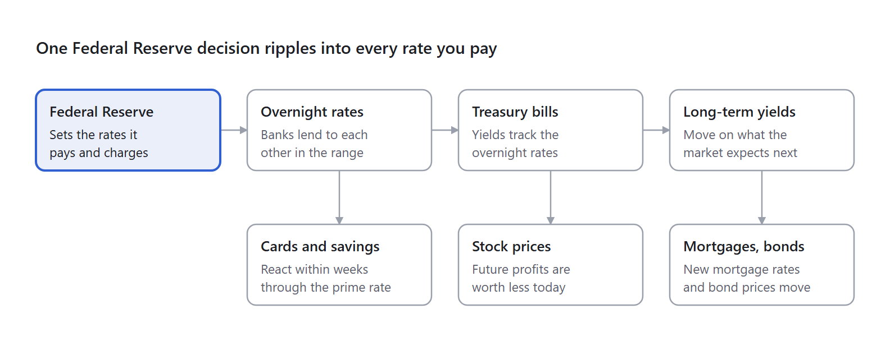

# Treasury Securities and the Interest Rate System

_Notes by Daniel · last updated October 3, 2026_

Plain-language notes on United States Treasury bills, notes and bonds, how the Federal Reserve sets interest rates, the federal funds and repurchase agreement markets, the Federal Home Loan Banks, money market funds, hedge fund Treasury trades, securities dealers and the Fixed Income Clearing Corporation. Every special term is spelled out in full. Example figures are as of early October 2026.

---

## Contents

Read in order: the big picture below, then Parts 1 to 7, then the rules to remember. Part 1 lives in the Treasury Bonds folder, next to [Treasury Bonds — A Beginner's Guide](<Treasury Bonds (main).md>); Parts 2 to 7 live in this folder.

| Part | Note | What it covers |
|---|---|---|
| — | [The big picture](<Treasury Securities and the Interest Rate System (Main).md#The big picture>) (below) | The one chain from the Federal Reserve to every rate you pay · How to read the numbers |
| 1 | [How Treasury Bonds Work](<1 - How Treasury Bonds Work.md>) *(in Treasury Bonds)* | Treasury bills, notes, and bonds · The four terms that matter · Worked example: the 4.625% bond maturing February 15, 2055 · Buying and selling |
| 2 | [How the Fed Moves Your Rates](<2 - How the Fed Moves Your Rates.md>) | How the Federal Reserve sets rates · How much cash banks keep at the Federal Reserve · What "cash" means here · How it reaches you |
| 3 | [How Overnight Lending Works](<3 - How Overnight Lending Works.md>) | The federal funds market · The repurchase agreement market |
| 4 | [Banks That Lend to Banks](<4 - Banks That Lend to Banks.md>) | The Federal Home Loan Banks · What they are · What they sell · What they do with the money · How much collateral backs an advance · Why mortgages still work after 2008 · As an investment · If a bond is called · Payment schedules |
| 5 | [How Hedge Funds Use Leverage](<5 - How Hedge Funds Use Leverage.md>) | Money market funds · How a leveraged purchase works · Rolling the loan every morning · Strategy 1: earning the gap with leverage ("carry") · Strategy 2: the basis trade · Is the basis trade risk-free? · How big it is, and who does it |
| 6 | [How Middlemen Keep Borrowing Cheap](<6 - How Middlemen Keep Borrowing Cheap.md>) | What a dealer does · What the clearing house does · Sponsored clearing: why the middle gets cheaper |
| 7 | [When the System Breaks](<7 - When the System Breaks.md>) | 2008: the run on repurchase agreements · March 2020: when Treasury lending itself broke · 1998: the original hedge fund collapse · What changed afterward |
| — | [Rules to remember](<Treasury Securities and the Interest Rate System (Main).md#Rules to remember>) (below) | Fifteen rules that tie the whole chain together |
| — | [Sources](<Treasury Securities and the Interest Rate System (Main).md#Sources>) (below) | Federal Reserve, Federal Home Loan Banks, research, and news sources |

---

## The big picture

The Federal Reserve sets the base price of money, that price flows into every interest rate in the economy, and bond prices move in the opposite direction from those rates.

Everything in these notes is one chain. The Federal Reserve sets a few rates it controls directly, overnight lending markets follow them, Treasury yields follow those, and your credit card, savings account, mortgage, stocks, and bond prices adjust last. Figures are as of early October 2026.

*How a rate decision travels · 4 steps, 3 effects*

> [!info] The same diagram in words
> The main chain runs left to right, and each later link also pushes on something you deal with directly.
>
> 1. **Federal Reserve:** sets the rates it pays and charges.
> 2. **Overnight rates:** banks lend to each other inside the range the Federal Reserve set. Side effect: credit cards and savings accounts react within weeks, through the prime rate.
> 3. **Treasury bills:** their yields track the overnight rates. Side effect: stock prices adjust, because future profits are worth less today when rates are higher.
> 4. **Long-term yields:** these move on what the market expects next. Side effect: new mortgage rates and bond prices move.

Cards and savings react fastest; new mortgages and existing bonds follow long-term yields rather than the Federal Reserve directly.

**How to read the numbers:** the rates in these notes are one consistent snapshot from early October 2026, used so every worked example adds up. The levels will change, but these relationships stay true:

| Rate | Rule of thumb |
|---|---|
| Federal Reserve target range | A band 0.25 points wide, moved in steps of 0.25 at eight scheduled meetings a year |
| Standing repurchase agreement facility | The top of the range (the ceiling) |
| Interest on reserve balances | Inside the range, recently 0.10 below the top (the magnet) |
| Overnight reverse repurchase agreement facility | The bottom of the range (the floor) |
| Effective federal funds rate and Secured Overnight Financing Rate | Usually a few hundredths below interest on reserve balances, while reserves are plentiful |
| Prime rate | The top of the range plus 3 points |
| Three-month Treasury bill yield | Close to the overnight rates |
| New 30-year fixed mortgage | The 10-year Treasury yield plus roughly 1.5 to 2.5 points |

For current levels, check the Federal Reserve's H.15 release and the other sources at the end.

---

## Rules to remember

1. Bond prices and yields always move in opposite directions.
2. The payments are fixed, so the price you pay decides your return; cheaper means a higher yield.
3. A high yield is good when you buy; rising market yields are bad after you buy.
4. Holding to maturity removes price risk: every coupon plus full face value, whatever happens in between.
5. Longer bonds swing harder; a 30-year bond can drop about 15% if long-term rates rise one point.
6. Similar bonds are priced to similar yields, so a cheap bond is not automatically a bargain.
7. The Federal Reserve steers rates with offers, not orders: a ceiling, a magnet, and a floor.
8. Overnight markets are run by cash holders who cannot earn the reserve rate; banks that can mostly park their cash at the Federal Reserve.
9. The ordering of rates holds only while reserves are plentiful; when cash gets scarce, market rates can jump above the reserve rate.
10. In a leveraged purchase, the bond being bought is the collateral for the loan that pays for it.
11. An overnight loan can fund a months-long trade, because it is rolled over every morning.
12. Leverage turns small, stable spreads into big returns, and small price moves into big losses.
13. A hedge protects against price moves, not against higher borrowing costs.
14. The dealer earns the gap between two separate deals; the clearing house lets those deals cancel on paper, so the gap can stay tiny.
15. Every crisis follows the same path: lenders stop rolling, borrowers sell, prices fall, and only the central bank can replace the cash fast enough.

---

## Related Documents

- **[Treasury Bonds — A Beginner's Guide](<Treasury Bonds (main).md>)** — The introductory note on the same instruments: the three types, coupons versus discounts, and why prices and rates move in opposite directions.
- **[SOFR — Secured Overnight Financing Rate](<SOFR Future.md>)** — SOFR futures: contracts that bet on where the Secured Overnight Financing Rate will average in a future month or quarter.

---

## Sources

- [Federal Reserve implementation note, September 16, 2026](https://www.federalreserve.gov/newsevents/pressreleases/monetary20260916a1.htm)
- [Federal Reserve selected interest rates (H.15)](https://www.federalreserve.gov/releases/h15/)
- [Interest on reserve balances, Federal Reserve Bank of St. Louis](https://fred.stlouisfed.org/series/IORB)
- [Secured Overnight Financing Rate, Federal Reserve Bank of St. Louis](https://fred.stlouisfed.org/series/SOFR)
- [Treasury yields, Trading Economics](https://tradingeconomics.com/united-states/government-bond-yield)
- [Moody's downgrade of the United States, May 2025](https://ratings.moodys.com/ratings-news/443154)
- [Federal Home Loan Banks combined financial report, end of 2024](https://www.fhlb-of.com/ofweb_userWeb/resources/2024Q4CFR.pdf)
- [Federal Home Loan Banks lending and collateral disclosures](https://www.fhlb-of.com/ofweb_userWeb/resources/lendingqanda.pdf)
- [Federal Housing Finance Agency report on collateral pledged to the Federal Home Loan Banks](https://www.fhfa.gov/document/d/fhlb-c/collateral-pledged-to-fhlbanks-2018)
- [Webull bond trading help](https://www.webull.com/help/faq/11018-Bond-Trading)
- [Charles Schwab on agency bonds](https://www.schwab.com/learn/story/us-agency-bonds-what-you-should-know)
- [Federal Reserve Bank of New York on sponsored clearing of repurchase agreements](https://libertystreeteconomics.newyorkfed.org/2025/10/the-rise-of-sponsored-service-for-clearing-repo)
- [Federal Reserve Bank of New York on who borrows and lends in repurchase agreement markets](https://libertystreeteconomics.newyorkfed.org/2026/09/whos-borrowing-and-lending-in-repo-markets/)
- [Office of Financial Research on the overnight tri-party repurchase agreement market](https://www.financialresearch.gov/briefs/files/OFRBr_21-02_Dynamics_Overnight_Triparty_Repo_Market.pdf)
- [BofA Securities on Treasury central clearing deadlines](https://business.bofa.com/en-us/content/ust-and-repo-clearing.html)
- [Federal Reserve note on hedge funds' Treasury exposures](https://www.federalreserve.gov/econres/notes/feds-notes/decomposing-hedge-funds-u-s-treasury-exposures-20260622.html)
- [Office of Financial Research on hedge funds' cash Treasury holdings](https://www.financialresearch.gov/the-ofr-blog/2026/08/19/hedge-funds-cash-treasury-holdings/)
- [CNBC on hedge funds' share of the Treasury market](https://www.cnbc.com/2026/09/30/us-treasury-market-is-relying-more-on-hedge-funds.html)
- [Research paper on hedge funds and the Treasury basis trade](https://www.sciencedirect.com/science/article/abs/pii/S0304393225000947)
